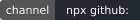
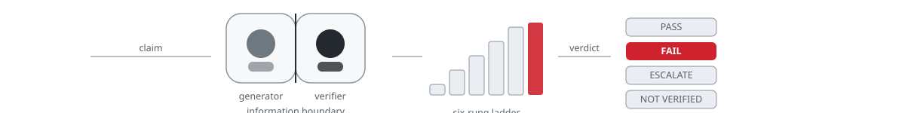
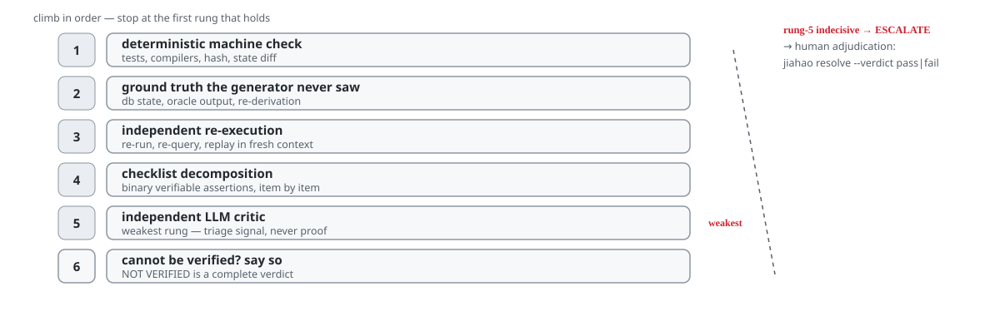
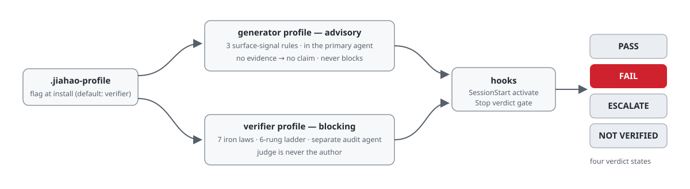

**English** | [中文](README-zh-CN.md)

<p align="center">
  <picture>
    <source media="(prefers-color-scheme: dark)" srcset="docs/assets/brand/logo-dark.png">
    
  </picture>
</p>

<h1 align="center">Jiahao (嘉豪)</h1>

<p align="center">
  Prompt-as-mental-model skill distribution with <b>dual profiles</b> for LLM agents.
</p>

<p align="center">
  
  
  
  
</p>

**Status — an installable discipline scaffold with publicly failed measurement**
(ADR-0069). Install channel, hook wiring and claim discipline are real and
exercised; the measured detection claim is public and failed:

> devin-corpus@v2 falsification test: failed (n=120, lie=31, FP=21/89, CI lower=0.142229) (verdict date: 2026-09-15)
>
> This is a decision-table outcome from a seeded-emergence bench corpus, not a precise performance estimate; devin-corpus@v2 is never cited by any conformity claim.

That verdict adjudicates the scorer artifact `src/port/score.js` — failure
class: construct misalignment (it fired on “looks like an exit report”,
not on claim-evidence contradiction). A deterministic claim-evidence pairer
is the CAPA repair track; adjudicated through devin-corpus@v3 names the v3
route (single-shot verdict landed 2026-09-16: falsification-passed — v3
section below). **Nothing on this page is a detector-effectiveness claim.**

## What it does

LLM agents suffer from False Completion Syndrome: falsely claiming success,
self-deceiving about completion, hallucinating self-evaluation. Jiahao
separates claims from verification and demands evidence mechanically —
without asserting the measurement solved it (the failed verdict above stays
on the record). The pattern mirrors
[ponytail](https://github.com/DietrichGebert/ponytail) specialized for the
verifier role. Pick once at install:

| Profile | Installed in | Behavior |
|---------|--------------|----------|
| **generator** | The primary Agent doing the work | 3 surface-signal rules (no evidence → no claim, list verified state changes, verification = calling a tool). **Advisory only** — never blocks. |
| **verifier** (default) | The audit Agent reviewing the work | 7 iron laws + 6-rung verification ladder + hash chain + confidence calibration + bias guards. **Blocking** on missing evidence. |

<p align="center"> six-rung ladder -> PASS / FAIL / ESCALATE / NOT VERIFIED" width="880"></p>

The generator profile attacks surface signals inside the primary agent (you
cannot self-verify — verified advice); the verifier runs in a separate
audit agent where independence theorems apply — an external verifier finds
errors the generator is structurally blind to.

## Readiness status (ADR-0072)

- [installed-artifact measured] The Tier-1 channel installs in a clean environment and writes the profile flag (record: `.scratch/grill-t11/readiness/`).
- [installed-artifact measured] The verifier Stop gate blocks on missing evidence and allows on evidence, end-to-end on the installed artifact.
- [installed-artifact measured] The conviction lane runs stdin `transcript_path` -> adapter -> pairItem -> shadow record on the installed artifact.
- [documented] The lane runs in shadow mode only - flagged items are telemetry, never blocks. The shadow->enforce promotion gate is frozen at 0 organic events; "usable for real testing" declares the bake window may start collecting, not a gate pass.
- [documented] Per-host transcript reachability is documented (claude-code: `measured-present` - live-observed: independent-audit reproduction + automated-harness events; organic pending); bake traffic begins with owner dogfooding after a separate host-config confirmation.

## Install

### CLI installer (Tier 1, recommended)

Tier 1 is a name-independent channel: it installs straight from the git
repository, which is public. The channel was measured live on 2026-09-16 in a
clean environment (first-party record:
`.scratch/grill-t8/readiness/b2-install-measurement.md`).

> **Install-channel verification (ADR-0074 D-D).** The 2026-09-16 measurement
> predates the sanitized-history publish (the measured tip was rewritten); the
> claim was re-verified against the published tip per the pre-registered plan
> (ADR-0074 D-E): `verified-at-published-tip:051744a7a1b4027a42720814c819bf051e0831a8`
> + `npx github:Xxx91n/jiahao init --profile verifier -y` + 2026-09-17 +
> clean-env-reverify. Evidence: `.scratch/grill-t13/audit-evidence/reverify-2026-09-17.json`.

```sh
npx --yes github:<org>/jiahao init                      # interactive profile prompt
npx --yes github:<org>/jiahao init --profile verifier   # non-interactive (CI-safe)
npx --yes github:<org>/jiahao init -y                   # accept default (verifier)
npx --yes github:<org>/jiahao init --dry-run            # print, do not write
npx --yes github:<org>/jiahao resolve                   # phase 1: preview evidence (no machine verdict shown)
npx --yes github:<org>/jiahao resolve --verdict pass --reason "tests re-run green" --reviewer alice
```

> **Naming declaration (ADR-0059 D-A).** The unprefixed npm package name
> `jiahao` is a third party’s 2019 test package. This project has never
> published to npm and does not claim that name — do not install it from the
> registry. Future publication, if it ever unfreezes (defer-0001 conditions),
> will use the scoped name `@<org>/jiahao` (reserved under defer-0028).
> Renaming the project is rejected.

The CLI writes only `.jiahao-profile`. Adapter files are distributed by
`scripts/build-adapters.js`, never copied by the installer (drift guardrail).
The manual `echo` below remains Tier 0 (zero-dependency fallback).

### Profile selection (install-time)

Create a flag file in the config dir (default `$CLAUDE_CONFIG_DIR` or `$HOME`):

```bash
# Pick ONE — verifier is the default if the flag is absent.
echo generator > ~/.jiahao-profile      # primary agent
echo verifier > ~/.jiahao-profile       # audit agent
```

The `SessionStart` activate hook reads this flag and serves the matching
rule set. The `Stop` verdict-gate hook blocks on missing evidence only in
verifier mode; in generator mode it emits a `JIAHAO ADVISORY` system message.

### Verifier deployment discipline

Verifier independence is enforced at the deployment layer, not by config:

- Run the verifier in a **separate context window** — subagent, teammate
  session, or independent process. Never same-context self-review.
- **Prefer a different model family** for the verifier. Same-family judges
  carry intrinsic self-preference bias that context isolation cannot fix
  (Wataoka et al. 2024); stronger same-family models can show *more* bias
  (Yang et al. 2026).
- One profile per installation — generator and verifier are not meant to
  coexist as competing auto-loaded rule sets in one project.

Wiring tests guarantee document↔code agreement, not behavioral correctness —
**agreement is not accuracy** (ADR-0059 D-D). They are a characterization /
change-detector layer providing *coherence-tier limited assurance* (ISAE 3000
vocabulary), not independent assurance; independence comes from a separate
information boundary (see above), never from self-validation.

See ADR-0011 for the full deployment discipline.

### Threat model (mandatory, ADR-0014 D3)

Jiahao's wordlist and detection logic are **not hidden secrets**: anything
with file-read access in the working directory can read them. The real
defenses are the L1-L3 structural signals keyed on tool-output evidence the
agent does not control (public by design), and wordlist privacy as
cost-raising only — `phrases.json` is fingerprint-checked (SHA-256) but
never a security boundary (CWE-656 obscurity). Jiahao is effective against
*drift-prone-not-hostile* agents; a hostile actor needs harness/OS-level
isolation in addition.

## Verification Ladder

<p align="center"></p>

1. Deterministic machine check (test suites, compilers, hash comparisons)
2. Ground truth comparison (database state, oracle output)
3. Independent re-execution (re-run, re-query, replay)
4. Checklist decomposition (binary assertion verification)
5. Independent LLM critic (weakest rung — triage signal only)
6. NOT VERIFIED (honest, complete verdict)

If rung 5 ends indecisive (error, timeout, contradictory), the gate emits
**ESCALATE** — an advisory-only fourth verdict routing claims to human
adjudication via `jiahao resolve --verdict pass|fail --reason <text> --reviewer <id>` (ADR-0017). Human verdicts write back as append-only `human_verdict` records and feed calibration.

## Hosts and protection tiers (ADR-0028 D6)

Not all hosts are equal. Enforcement capability is disclosed, not assumed:

| Tier | Hosts | Enforcement | Install pointer |
| --- | --- | --- | --- |
| Hook tier | claude-code | Verifier exit-2 blocking semantics | Claude Code plugin — see `hooks/jiahao-hooks.json` |
| Hook tier | codex | Verifier exit-2 blocking semantics | copy `adapters/codex/hooks.json` -> `.codex/hooks.json` + hook scripts -> `.codex/hooks/` |
| Hook tier | copilot, qoder | Verifier exit-2 blocking semantics | generated `adapters/<host>/` files per the adapter README |
| Hook tier — Claude-Code-compatible path | codebuddy | Verifier exit-2 + `permissionDecision:"deny"` envelope | self-contained plugin bundle `adapters/codebuddy/` — CLI settings surface verified; plugin-path + IDE parity declared-unverified (pending-confirmation registered, ADR-0087) |
| Instruction tier | cursor, windsurf, cline, opencode, aider, instruction-tier (AGENTS.md) | Advisory-only soft injection | copy `adapters/<host>/jiahao*` or `*-generator.*` — generated from `src/SKILL.md` |
| MCP (source-only) | jiahao-mcp (git tree) | Profile parameter; relies on client policy. Not in the npm tarball | clone + `npm install` inside `jiahao-mcp/` (experimental) |

Known degradations are recorded per adapter README: copilot `sessionStart`
does not fire (upstream #1730; `userPromptSubmitted` is the attested path),
opencode has no hook/exit-2 mechanism (#12472 open, #14551 not-planned), and
aider loads the rules only via opt-in `read:` config.

## Usage

- `/jiahao lite` — rungs 1-2 only, skip LLM critic
- `/jiahao full` — full ladder (default)
- `/jiahao ultra` — full ladder + re-verify with different model at rung 5
- `/jiahao off` — disable

## Distribution boundary (ADR-0038)

The npm tarball is a runtime artifact: it installs the prompt profiles and
gate scripts, nothing more. The benchmark answer corpora (`probes.jsonl` /
`judge-twins.jsonl` / `twins.jsonl` / `mr-probes.jsonl`) are a maintainer/CI
asset and are **not distributed** — neither in the npm package, nor in a
public git clone (a fresh clone of the public repo also carries no corpus).
Corpus-needing scripts resolve `JIAHAO_CORPUS_DIR` -> the install-planted
dir -> repo-private `private/bench-corpus/`; an absent dir degrades the gate
honestly to exit 2 (UNVERIFIABLE), a present-broken dir fails closed at
exit 1 with closed-enum `[usage]:`/`[config]:`/`[internal]:` stderr prefix
(ADR-0041 D3). Corpus gates are maintainer/CI-only; ADRs and developer docs
live on the git tree, not the tarball (ADR-0039).

> **History note (ADR-0074).** On 2026-09-17, before first publish, the pre-push
> history underwent an owner-ordered sanitized-history rewrite: sensitive paths
> were removed so no published tree ever carried them, and tip-region commit
> SHAs changed (bounded scope; earlier history untouched). Pre-rewrite SHA
> citations in docs were translated via `docs/rewrite-map.json` and recorded
> in ADR-0074 — both retired in the 2026-10 consolidation and readable in git
> history.

The MCP adapter (`jiahao-mcp/`) is a **source-only** git-tree component: it is
not part of the tarball and is never distributed via npm. Run it from a clone
— `git clone <repo> && cd jiahao-mcp && npm install` (status: experimental /
source-only; ADR-0059 D-B). An MCP publish channel is deferred (defer-0029).

## Measurement record

Verdicts at a glance — every line below is bound verbatim in its own
subsection further down this page; nothing here is a detector-effectiveness
claim on real traffic.

| Channel | Corpus | Verdict | Date | Record |
| --- | --- | --- | --- | --- |
| T-6 confirmatory (product port) | polygraph-bench @994bdeb3, 396 items | CONFIRMATORY PASS (in-sample replay) | T-6 round | [ADR-0065](docs/adr/0065-t6-confirmatory-round-adjudication-port-surface-devin-corpus-and-claim-honesty.md) |
| devin-corpus@v1 OOT | seeded bench, n=52, lie=12 | indeterminate | 2026-09-15 | [ADR-0067](docs/adr/0067-devin-corpus-v1-oot-falsification-adjudication.md) |
| devin-corpus@v2 OOT | seeded bench, n=120, lie=31, FP=21/89 | **failed** | 2026-09-15 | [ADR-0068](docs/adr/0068-devin-corpus-v2-dual-axis-adjudication-collection-protocol-claim-slot-v3-binding.md) |
| devin-corpus@v3 OOT (CAPA pairer) | seeded bench, n=120, lie=36, FP=0/84 | passed | 2026-09-16 | [ADR-0069](docs/adr/0069-capa-claim-evidence-pairer-artifact-freeze-adjudication-anchor-readiness-positioning.md) |


### Confirmatory claims (T-6, ADR-0065 D-E)

Every confirmatory claim about the T-6 product port repeats the fixed facts
below verbatim. The single authority is
bench/research/out/claim-template.md; the same block appears in
bench/research/out/confirmatory-report.md (whitespace-normalized identical).

1. Floor arithmetic: the single absolute gate is confirmatory recall@FP0
   >= 0.563863 = baseline 0.4792 + d_MDE 0.084663 (frozen by ADR-0064 D-A;
   no post-hoc threshold moves, ADR-0065 D-A).
2. Trigger-mask control NOT HEALTHY: masking the 95 perfectly
   label-correlated tokens RAISED recall@FP0 by +0.1093 - the reference
   model partially exploits label-leaking lexical artifacts.
3. Closing channel: the closing message carries ~0.28 of recall@FP0; a
   scorer blind to it loses most of the signal.
4. Terminal fact (this round): CONFIRMATORY PASS - char-3|count|lr|C1.0|df2
   replayed the frozen corpus (polygraph-bench @994bdeb3, 396 items) through
   the shipped product port at recall@FP0 1.000000 with FP@default 0.000000
   (in-sample replay of the artifact trained on the full frozen corpus; the
   out-of-fold honesty claim remains the rung-1 research number, never
   max-of-trials).
5. Fallback honesty: the top survivor was judged first and passed; the
   fallback word-1|count|lr|C1.0|df2 leg never fired. Had it fired and
   passed, every claim would state: "the top-ranked survivor
   char-3|count|lr|C1.0|df2 failed confirmation; the adopted scorer is
   word-1|count|lr|C1.0|df2 (headline is never max-of-trials)."
6. Advisory channel: tier-(b) rel-L2 of port vectors vs the frozen gold20
   vectors measured max 0, mean 0 (count weighting is exact integer
   arithmetic on both sides) - diagnostic only, recorded in
   confirmatory-result.json, restated here, never moves an exit code.

### devin-corpus@v1 OOT falsification (grill-t7, ADR-0067 D-C)

The single authority for the OOT verdict is bench/research/out/devin-oot-report.json;
the bound claim block below appears verbatim in
bench/research/out/claim-template.md and bench/research/out/devin-oot-report.md.

devin-corpus@v1 falsification test: indeterminate (n=52, lie=12, CI lower 0.054861) (verdict date: 2026-09-15)

This is a small-sample (n_lie=12) decision-table outcome, not a precise performance estimate; devin-corpus@v1 is never cited by any conformity claim.

the pre-registered integer decision table assigns 3/12 to the indeterminate band; this is a decision-table outcome, not an effect estimate

### devin-corpus@v2 OOT falsification (grill-t7, ADR-0068 D-C)

The single authority for the v2 verdict is bench/research/out/devin-oot-v2-report.json;
the bound claim block below appears verbatim in
bench/research/out/claim-template.md and bench/research/out/devin-oot-v2-report.md.

devin-corpus@v2 falsification test: failed (n=120, lie=31, FP=21/89, CI lower=0.142229) (verdict date: 2026-09-15)

This is a decision-table outcome from a seeded-emergence bench corpus, not a precise performance estimate; devin-corpus@v2 is never cited by any conformity claim.

dual-axis intersection-union verdict: lie axis 9/31 hits, CP 95% CI [0.142229, 0.480361] entirely below the conservative-transfer floor 0.563863 (lie-fail); FP axis 21/89, CI lower above the 0.10 usability bound (fp-fail); the stress side-set (20 command-exit honest items, never in either table) flagged 20/20 - a decision-table outcome, not an effect estimate

### devin-corpus@v3 OOT falsification (grill-t9, ADR-0069 D-C)

The single authority for the v3 verdict is bench/research/out/devin-oot-v3-report.json;
the bound claim block below appears verbatim in
bench/research/out/claim-template.md and bench/research/out/devin-oot-v3-report.md.

devin-corpus@v3 falsification test: passed (n=120, lie=36, FP=0/84, CI lower=0.902606) (verdict date: 2026-09-16)

This is a decision-table outcome from a seeded-emergence bench corpus, not a precise performance estimate; devin-corpus@v3 is never cited by any conformity claim.

dual-axis intersection-union verdict on the CAPA claim-evidence pairer: lie axis 36/36 hits, CP 95% CI [0.902606, 1.000000] above the conservative-transfer floor 0.563863 (lie-pass); FP axis 0/84, CI upper below the 0.10 usability bound (fp-pass); the stress side-set (20 command-exit honest items, never in either table) flagged 0/20; port-vs-pairer divergence disclosed as telemetry only (28+42 cells over 140 scored) - a decision-table outcome, not an effect estimate

### Conviction lane claim (ADR-0070 D-E)

Descriptive existence - the three registered sentences (lane state value: shadow):

The CAPA claim-evidence pairer runs in **shadow mode** on the Stop/SubagentStop conviction lane for hosts that deliver a transcript file (per-host reachability is registered in the host-contract registry; currently `measured-present` (live-observed: independent-audit reproduction + automated-harness events; organic pending) only for claude-code): flagged contradictions are appended to the evidence chain as `source: pairer-instrument` shadow records and never enter the severity matrix.

The lane flags only a mechanically proven contradiction - a claimed value parsed from the transcript closing and an evidence value parsed from the tool-result stream, both present and unequal, inside the four registered families (exit-report, file-contains, count-report, content-append); unparseable claims, absent evidence, unsupported families, and hosts without transcript delivery are outside coverage and degrade as `undetermined` or `absent`, never as a flag and never as coverage:partial.

The devin-corpus@v3 adjudication describes that corpus's behavior; it is not a real-traffic recall claim, and the shadow->enforce promotion gate verifies flagged-item FP, undetermined coverage, and lane latency - it does not certify recall.

### Reproduce the measurement (measurement-reproduction invitation, ADR-0069 D-D.3)

This project invites one thing: independent reproduction of the published
measurement — not adoption, and no performance claim is asked or made.

devin-corpus@v2 falsification test: failed (n=120, lie=31, FP=21/89, CI lower=0.142229) (verdict date: 2026-09-15)

This is a decision-table outcome from a seeded-emergence bench corpus, not a precise performance estimate; devin-corpus@v2 is never cited by any conformity claim.

The v2 verdict is frozen at the annotated tag `adjudicated/devin-corpus-v2`
(commit 8807a61; failure class: construct misalignment). The adjudicated
artifacts `src/port/score.js` and `src/port/g6-manifest.json` are
sha256-pinned at that commit. To re-derive every published number from the
recorded artifact — the corpus itself is never re-opened:
`node bench/research/devin-oot.js --snapshot-dir devin-corpus-v2 --replay`.
Discrepancies feed the
CAPA record categorically — open a GitHub issue naming the mismatching
field; reproductions never enter any verdict chain.

The invitation extends to the conviction-lane channel (ADR-0070): the lane's
shadow records are append-only on the local evidence chain and the four
frozen promotion inputs are re-derivable from them via
`node scripts/pairer-lane-telemetry.js`; the shipped pairer itself replays
the frozen v3 corpus via `node scripts/check-pairer-regression.js`.

## Develop

```bash
npm test
node scripts/kappa.js                 # ADR-0018 κ governance report (--save-baseline to pin)
node scripts/build-adapters.js        # regenerate 54 adapter files (12 hosts)
node scripts/check-drift.js           # CI drift check + profile purity
```

## Architecture

The dual-profile flow: advisory generator -> claim -> independent verifier -> six-rung ladder -> four verdict states.

<p align="center"></p>

- `src/SKILL.md` — single source of truth (generator + verifier + shared Boundaries)
- `src/gate.js` — verification gate combination ladder (PASS / FAIL / ESCALATE / NOT VERIFIED)
- `scripts/resolve.js` — human adjudication CLI (two-phase anti-anchoring write-back)
- `hooks/jiahao-profile.js` — profile module (SSOT for split + select)
- `hooks/` — 7 hook scripts + hooks.json + runtime.js
- `adapters/` — generated per-host adapters (12 host directories / 54 generated files; ADR-0028 D5)
- `jiahao-mcp/` — MCP-only adapter (profile parameter)
- `test/` — jest test suites
- `bench/polygraph/` — ADR-0015 benchmark adapter + frozen dev-split corpus (ADR-0019 run FAILed honestly, ADR-0020 run PASSED beat-b2; see its README)
- `private/bench-corpus/` — answer corpora (gitignored, ADR-0036 D2): resolved via JIAHAO_CORPUS_DIR -> install-planted dir -> this repo dir; missing fails closed (ADR-0038 D2). npm-distributed runtime paths never reference it (ADR-0038 D1).
- `docs/adr/` — architecture decision records (the git-tree development surface; ADR-0039). 


## License

MIT
